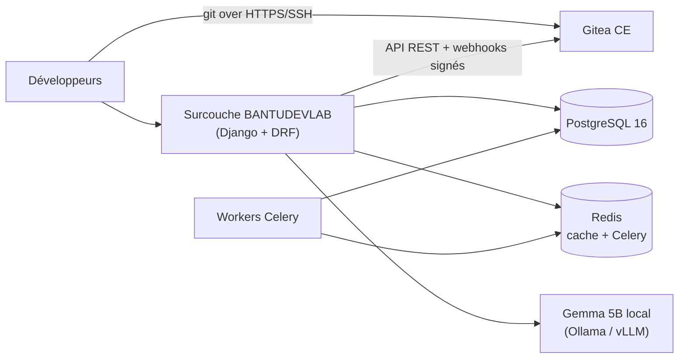

# BANTUDEVLAB - Forge Logicielle Souveraine de l'Afrique

> **BANTUDEVLAB** centralise le code des développeurs africains sur une infrastructure souveraine : moteur Git (Gitea), authentification sans mot de passe par preuve à divulgation nulle de connaissance (ZKP), scanner de sécurité et de souveraineté, et assistant IA local (Gemma 5B).

## Sommaire

1. [Architecture](#architecture)
2. [Stack technique](#stack-technique)
3. [Démarrage rapide](#démarrage-rapide)
4. [Sécurité](#sécurité)
5. [Authentification Zero-Trust (ZKP)](#authentification-zero-trust-zkp)
6. [Scanner de sécurité](#scanner-de-sécurité-et-score-de-souveraineté)
7. [API](#api)
8. [Interface et icônes](#interface-et-icônes)
9. [Tests et CI/CD](#tests-et-cicd)
10. [Documentation](#documentation)

## Architecture



PostgreSQL et Redis ne sont joignables que depuis le réseau Docker interne (`backend_net`).

## Stack technique

| Couche | Technologie |
|---|---|
| Backend | Python 3.12+, Django 5.1, Django REST Framework, drf-spectacular |
| Forge Git | Gitea 1.23 (rootless) |
| Données | PostgreSQL 16 (SQLite en développement), Redis 7 |
| Asynchrone | Celery |
| IA | Gemma 5B (fine-tuning LoRA/QLoRA dans `finetuning/`) |
| Serveur | Gunicorn + Uvicorn workers |
| Qualité | pytest, coverage, ruff, bandit, Playwright |

## Démarrage rapide

### 1. Configurer l'environnement

```bash
cp .env.example .env
# Éditez .env : remplacez TOUTES les valeurs CHANGE_ME
python -c "import secrets; print(secrets.token_urlsafe(64))"   # pour DJANGO_SECRET_KEY et GITEA_WEBHOOK_SECRET
```

Sans `DJANGO_SECRET_KEY`, l'application refuse de démarrer en production (`DEBUG=False`, valeur par défaut).

### 2. Docker Compose (environnement complet)

```bash
docker compose up -d --build
```

Variables obligatoires : `DJANGO_SECRET_KEY`, `POSTGRES_PASSWORD`, `REDIS_PASSWORD`, `GITEA_WEBHOOK_SECRET`.

### 3. Exécution locale (développement)

```bash
python -m venv .venv && source .venv/bin/activate    # Windows : .venv\Scripts\activate
pip install -r requirements.txt
export DEBUG=True
python manage.py migrate
python manage.py runserver
```

## Sécurité

- Authentification obligatoire par défaut sur l'API ; seuls l'inscription, le défi, la vérification ZKP, les statuts et le webhook signé sont publics.
- Défis ZKP à usage unique, consommés de manière atomique (anti-rejeu), y compris pour l'émission de tokens Git.
- Webhook Gitea vérifié par HMAC-SHA256 ; désactivé (503) si aucun secret n'est configuré.
- En production : HTTPS forcé, HSTS, cookies `Secure`, CSP, `Referrer-Policy`, `COOP`.
- Journal d'audit chaîné par hachage (`AuditTrail`), insertion transactionnelle.
- Secrets masqués avant toute persistance des requêtes à l'IA.
- Conteneurs durcis : `no-new-privileges`, `cap_drop: ALL`, utilisateur non root.

Voir [SECURITY.md](SECURITY.md) et [docs/security/threat-model.md](docs/security/threat-model.md).

## Authentification Zero-Trust (ZKP)

Protocole d'identification de Schnorr rendu non interactif (Fiat-Shamir) sur le groupe MODP 2048 bits (RFC 3526). Le serveur ne reçoit et ne stocke que la clé publique `y = g^x mod p` ; le secret `x` ne quitte jamais le poste du développeur.

1. `POST /api/zkp/register/` - enregistre l'identité (clé publique validée contre les attaques de petit sous-groupe).
2. `POST /api/zkp/challenge/` - émet un nonce à usage unique (5 minutes).
3. `POST /api/zkp/verify/` - vérifie la preuve `(t, s)` et ouvre la session.
4. `POST /api/zkp/tokens/generate/` - émet un token Git (`read`, `write`, `admin`, 1 à 365 jours) contre une preuve valide.

## Scanner de sécurité et score de souveraineté

`POST /api/security/scan/` analyse un fichier (secrets en dur, injections, `eval`/`exec`, dépendances non souveraines) et calcule un score de 0 à 100. Les rapports sont exportables au format SARIF 2.1.0 (`/api/security/sarif/`).

## API

- Documentation interactive : `/api/docs/` (Swagger) et `/api/redoc/`.
- Schéma OpenAPI : `/api/schema/`.
- Santé : `/healthz` (liveness) et `/readyz` (base de données et cache).

## Interface et icônes

L'interface n'utilise **aucun emoji** : les icônes sont des SVG auto-hébergés (aucun CDN) rendus par les balises `` et `` (voir `apps/core/templatetags/icons.py`).

```django


```

Le contrôle `python scripts/check_no_emoji.py` est exécuté par les tests et la CI.

## Tests et CI/CD

```bash
pytest                      # suite complète (couverture minimale configurée dans pyproject.toml)
ruff check . && bandit -r apps config -c pyproject.toml
python scripts/check_no_emoji.py
```

La CI GitHub Actions (`.github/workflows/ci.yml`) exécute lint, tests, analyse de sécurité, validation de la configuration Docker Compose et construction de l'image.

## Documentation

| Document | Contenu |
|---|---|
| [docs/architecture.md](docs/architecture.md) | Architecture et décisions (ADR) |
| [docs/security/threat-model.md](docs/security/threat-model.md) | Modèle de menaces (STRIDE) |
| [docs/security/crypto-spec.md](docs/security/crypto-spec.md) | Spécification du protocole ZKP |
| [docs/operations.md](docs/operations.md) | Déploiement, sauvegardes, runbook |
| [docs/pitch-cadev-2026.md](docs/pitch-cadev-2026.md) | Pitch de 10 minutes pour la CADEV 2026 |
| [CONTRIBUTING.md](CONTRIBUTING.md) | Guide de contribution |
| [CHANGELOG.md](CHANGELOG.md) | Historique des changements |
| [backlod.md](backlod.md) | Backlog d'amélioration et avancement |
