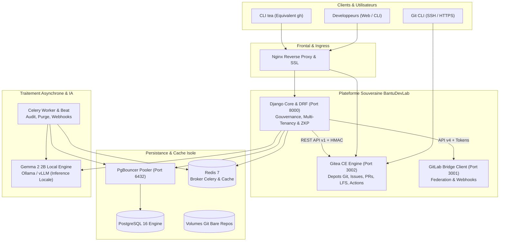
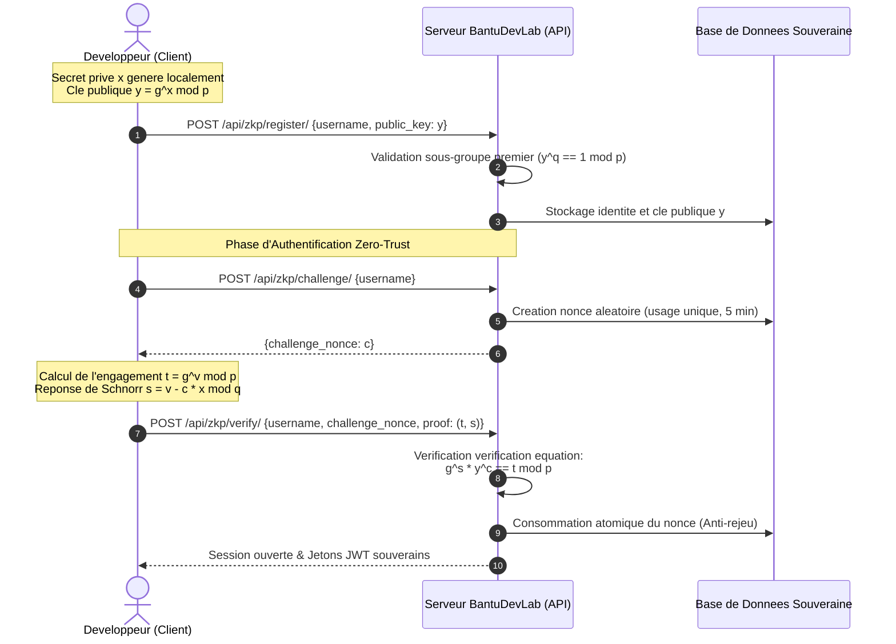

# BANTUDEVLAB - Forge Logicielle Souveraine de l'Afrique

> **BANTUDEVLAB** centralise le code des développeurs africains sur une infrastructure souveraine et sécurisée : moteur Git résilient (Gitea / GitLab), authentification Zero-Trust sans mot de passe par preuve à divulgation nulle de connaissance (ZKP), scanner de sécurité et d'entropie de Shannon (SAST / SARIF 2.1.0), et assistant IA local (Gemma 2 2B) optimisé pour l'inférence locale et l'embarqué sans dépendance externe.

---

## Sommaire

1. [Vision et Philosophie Souveraine](#vision-et-philosophie-souveraine)
2. [Architecture Globale](#architecture-globale)
3. [Stack Technique Complète](#stack-technique-complète)
4. [Démarrage Rapide](#démarrage-rapide)
5. [Sécurité et Hardening](#sécurité-et-hardening)
6. [Authentification Zero-Trust ZKP (Schnorr / Fiat-Shamir)](#authentification-zero-trust-zkp-schnorr--fiat-shamir)
7. [Scanner SAST Shannon & Conformité SARIF 2.1.0](#scanner-sast-shannon--conformité-sarif-210)
8. [Assistant IA Local Gemma 2 2B & Copilot Souverain](#assistant-ia-local-gemma-2-2b--copilot-souverain)
9. [Equivalence Fonctionnelle GitHub via Gitea](#equivalence-fonctionnelle-github-via-gitea)
10. [Cycles de Développement Continu (Dossier TASK)](#cycles-de-développement-continu-dossier-task)
11. [API et Documentation Interactive](#api-et-documentation-interactive)
12. [Interface Souveraine et Charte Graphique](#interface-souveraine-et-charte-graphique)
13. [Tests, CI/CD et Qualité](#tests-cicd-et-qualité)
14. [Index de la Documentation](#index-de-la-documentation)

---

## Vision et Philosophie Souveraine

BANTUDEVLAB répond aux impératifs d'indépendance numérique et technologique du continent africain, en accord avec la **Convention de Malabo (2014)** sur la cybersécurité et la protection des données à caractère personnel ainsi que les directives de l'Union Africaine :

- **Souveraineté des Données :** Hébergement sur le sol africain (aucun transfert vers des hyperscalers tiers).
- **Zéro Dépendance aux CDN Tiers :** Tous les composants frontaux (styles Primer, polices, scripts CodeMirror, icônes SVG) sont auto-hébergés localement.
- **Zéro Emoji :** Respect d'une interface professionnelle sobre et accessible, excluant tout caractère emoji au profit d'icônes vectorielles SVG souveraines.
- **Résilience et Mode Déconnecté :** Fonctionnement garanti en intranet ou réseau isolé avec modèles d'intelligence artificielle compacts exécutés en local (quantification GGUF 4-bit).

---

## Architecture Globale

L'infrastructure BANTUDEVLAB s'articule autour d'une architecture hybride associant un moteur Git ultra-performant et une surcouche de gouvernance souveraine en Python / Django :



---

## Stack Technique Complète

| Domaine | Composant | Rôle & Spécificités |
|---|---|---|
| **Backend Core** | Python 3.12, Django 5.2, DRF 3.18 | API REST, multi-tenancy souverain, gouvernance des organisations |
| **Forge Git** | Gitea CE 1.23+ / GitLab CE 16.11 | Dépôts Git, Pull Requests, Code Review, Registres de paquets |
| **Base de Données** | PostgreSQL 16 + PgBouncer | Stockage relationnel haute performance avec pooling de connexions |
| **Cache & Tâches** | Redis 7 + Celery 5.6 | Files d'attente asynchrones, invalidation de cache, sessions |
| **Intelligence Artificielle** | Gemma 2 2B (Google) | Modèle souverain compact (2 milliards de paramètres), QLoRA / GGUF |
| **Cryptographie** | Cryptography 50+, hashlib | Zero-Knowledge Proofs Schnorr/Fiat-Shamir, SHA-256 Chained Audit |
| **Serveur ASGI/WSGI** | Gunicorn + Uvicorn Workers | Serveur d'application durci avec dimensionnement dynamique |
| **Interface Utilisateur** | Primer CSS, SVG natifs, CodeMirror | Équivalence visuelle GitHub, thème sombre/clair, sans CDN |
| **Assurance Qualité** | Pytest, Coverage (> 95%), Ruff, Bandit | Analyse statique, fuzzing cryptographique, tests end-to-end |

---

## Démarrage Rapide

### 1. Préparation des variables d'environnement

Copiez le modèle d'environnement et générez les secrets cryptographiques requis :

```bash
cp .env.example .env
# Generer des cles securisees
python -c "import secrets; print('DJANGO_SECRET_KEY=' + secrets.token_urlsafe(64))"
python -c "import secrets; print('GITEA_WEBHOOK_SECRET=' + secrets.token_hex(32))"
```

### 2. Déploiement Conteneurisé avec Docker Compose

L'intégralité des services (Django, Gitea, PostgreSQL, Redis, Celery) démarre en une seule commande :

```bash
docker compose up -d --build
```

Consultez le guide détaillé : [docker-deployment.md](docker-deployment.md).

### 3. Exécution Locale en Environnement de Développement

```bash
# Creation et activation de l'environnement virtuel
python -m venv .venv
source .venv/bin/activate  # Sous Windows : .venv\Scripts\activate

# Installation des dependances
pip install -r requirements.txt

# Application des migrations de base de donnees
python manage.py migrate

# Demarrage du serveur de developpement
python manage.py runserver 0.0.0.0:8000
```

---

## Sécurité et Hardening

- **Contrôle d'accès par défaut :** Toutes les routes de l'API requièrent une authentification par défaut (`IsAuthenticated`), à l'exception des points de terminaison cryptographiques publics (inscription ZKP, défi de challenge, vérification de preuve, santé).
- **Audit Trail Immuable :** Chaque action critique (connexion ZKP, création de dépôt, scan SAST, approbation de MR) est inscrite dans `AuditTrailLog` avec chaînage cryptographique SHA-256 (`previous_hash -> hash`) pour garantir la non-répudiation (vérifiable via `python manage.py export_malabo_compliance_report`).
- **En-têtes de Sécurité HTTP :** CSP strict sans `'unsafe-inline'` externe, HSTS avec préchargement, protection contre le clickjacking (`DENY`), isolation d'origine croisée (`COOP`/`COEP`).
- **Conteneurs Hardened :** Exécution sous utilisateur non-privilégié (`appuser:appgroup`, UID 1000), `read_only_root_filesystem`, et révocation de toutes les capacités Linux (`cap_drop: ALL`).

---

## Authentification Zero-Trust ZKP (Schnorr / Fiat-Shamir)

Le protocole d'identification de Schnorr non interactif (transformée de Fiat-Shamir) est implémenté sur le groupe RFC 3526 MODP 2048 bits ($p, q, g$).



- `POST /api/zkp/tokens/generate/` : Émission de jetons Git sécurisés (`read`, `write`, `admin`) protégés par preuve ZKP.
- Spécifications cryptographiques complètes : [docs/security/crypto-spec.md](docs/security/crypto-spec.md).

---

## Scanner SAST Shannon & Conformité SARIF 2.1.0

Le module `apps/security_scanner` intègre un moteur d'analyse statique de sécurité (SAST) multi-langages :
- **Calcul d'Entropie de Shannon :** Détection automatique des clés privées, jetons d'accès et secrets enfouis dans le code source ($H \ge 3.8$).
- **Règles Anti-Vulnérabilités :** Injections SQL, fonctions d'exécution arbitraire (`eval`, `exec`), failles XSS, et bibliothèques non souveraines.
- **Formats Standards d'Exportation :** Rapports complets conformes à la norme internationale OASIS SARIF 2.1.0 (`/api/security/sarif/`) et format natif GitLab SAST (`gl-sast-report.json`).

---

## Assistant IA Local Gemma 2 2B & Copilot Souverain

BANTUDEVLAB intègre en local le modèle open-weights **Gemma 2 2B** développé par Google DeepMind, adapté aux contraintes de souveraineté et d'exécution locale :

- **Revue Autonome de Pull Requests :** Tâche d'arrière-plan Celery analysant les diffs Git, commentant les propositions de code et soumettant des suggestions structurées.
- **Spotlight Palette & Raccourcis Clavier :** Palette de commandes accessible via `Ctrl+K` ou `Cmd+K` pour rechercher des fichiers, naviguer ou invoquer l'IA.
- **Exportation de Sessions :** Sauvegarde et extraction des interactions Copilot au format Markdown ou JSON (`/api/ai/copilot/export/`).
- **Pipeline de Fine-Tuning Souverain :** Outils prêts à l'emploi dans `finetuning/` :
  - `dataset_preparation.py` : Génération de jeux de données d'instructions de cybersécurité.
  - `train_lora.py` : Fine-tuning compact par adaptateurs QLoRA.
  - `evaluate.py` : Évaluation automatique de conformité souveraine.
  - `export_gguf.py` : Conversion et quantification 4-bit (`q4_k_m`) pour inférence CPU/GPU ultra-rapide.

---

## Equivalence Fonctionnelle GitHub via Gitea

Le socle Gitea est personnalisé via des surcharges de templates Go (`custom/templates/`) et des styles Primer CSS pour offrir une parité visuelle et fonctionnelle totale avec GitHub :

- **Navigation & Vue Dépôt :** Arborescence interactive, sélecteur rapide de fichiers avec la touche `t`, affichage du `README.md` de profil pour l'utilisateur (`username/username`).
- **Gestion des Pull Requests :** Support complet des Draft Pull Requests (brouillons), Merge Box Primer, widget de suggestion de code multilignes et validation en 1 clic.
- **File de Fusion Souveraine (Merge Queue) :** Sérialisation FIFO et vérification automatisée de compatibilité avant intégration (`scripts/simulate_merge_queue.py`).
- **Graphe de Commits & Blame :** Heatmap interactive d'ancienneté des lignes de code et graphe topologique de branches en SVG multicolore.
- **Gestion de Projet & Équipes :** Jalons (Milestones) avec jauges de burndown, tableaux Markdown Primer avec tri par clic sur en-tête, et matrice à 5 rôles d'organisation (`Read`, `Triage`, `Write`, `Maintain`, `Admin`).
- **Avis de Sécurité (Security Advisories) :** Signalement confidentiel de failles avec calculatrice de sévérité CVSS v3.1.
- **Génération de Release Notes :** Agrégation automatique des PRs et contributeurs par catégorie (`scripts/generate_release_notes.py`).
- **Attestation SLSA & SBOM :** Génération de SBOM au standard CycloneDX v1.5 (`scripts/generate_sovereign_sbom.py`) et provenance cryptographique SHA-256 (`scripts/generate_release_provenance.py`).

---

## Cycles de Développement Continu (Dossier TASK)

Tous les plans directeurs, audits stratégiques et spécifications des 20 cycles de développement continu ont été classés dans le dossier dédié [`TASK/`](TASK/) :

| Fichier | Objet et Périmètre Opérationnel |
|---|---|
| [`TASK/task2.md`](TASK/task2.md) | Plan de déploiement en production industrielle et guide d'exploitation |
| [`TASK/TASK3.md`](TASK/TASK3.md) | Transition industrielle et intégration de la fédération GitLab CE/EE |
| [`TASK/TASK5.md`](TASK/TASK5.md) | Audit global de sécurité, catalogue des failles et plan directeur IA Gemma |
| [`TASK/TASK6.md`](TASK/TASK6.md) | Spécifications opérationnelles de transformation Gitea vers l'expérience GitHub |
| [`TASK/TASK7.md`](TASK/TASK7.md) | Cycle 1 : Copilot local Gemma 2 2B et Command Palette Spotlight (`Ctrl+K`) |
| [`TASK/TASK8.md`](TASK/TASK8.md) | Cycle 2 : PR Review Bot autonome (Celery), explorateur d'arborescence (`t`) |
| [`TASK/TASK9.md`](TASK/TASK9.md) | Cycle 3 : Heatmap Blame interactive, générateur de provenance SLSA v1 |
| [`TASK/TASK10.md`](TASK/TASK10.md) | Cycle 4 : Tableaux Markdown Primer avec tri dynamique interactif |
| [`TASK/TASK11.md`](TASK/TASK11.md) | Cycle 5 : Graphe de dépendances et exportateur CycloneDX v1.5 SBOM PURL |
| [`TASK/TASK12.md`](TASK/TASK12.md) | Cycle 6 : Dépôts épinglés Primer et profil README spécial (`user/user`) |
| [`TASK/TASK13.md`](TASK/TASK13.md) | Cycle 7 : Polyfill de réactions GitHub (`:+1:`, `:heart:`, `:rocket:`) sans emoji |
| [`TASK/TASK14.md`](TASK/TASK14.md) | Cycle 8 : Inspecteur d'historique de livraison de webhooks et simulateur de renvoi |
| [`TASK/TASK15.md`](TASK/TASK15.md) | Cycle 9 : Rulesets de branches et badges de signature de commits Verified |
| [`TASK/TASK16.md`](TASK/TASK16.md) | Cycle 10 : Centre de notifications GitHub (Inbox, filtres dynamiques, raccourci `m`) |
| [`TASK/TASK17.md`](TASK/TASK17.md) | Cycle 11 : Générateur automatique de notes de version à partir des PRs |
| [`TASK/TASK18.md`](TASK/TASK18.md) | Cycle 12 : Recherche de code avancée, qualificateurs de recherche (`path:`, `repo:`) |
| [`TASK/TASK19.md`](TASK/TASK19.md) | Cycle 13 : Polyfill de suggestions de modifications de code dans les PRs |
| [`TASK/TASK20.md`](TASK/TASK20.md) | Cycle 14 : Graphe de réseau de commits et visualisation topologique SVG |
| [`TASK/TASK21.md`](TASK/TASK21.md) | Cycle 15 : Jalons d'issues (Milestones) et calcul de burndown d'avancement |
| [`TASK/TASK22.md`](TASK/TASK22.md) | Cycle 16 : Gestion d'équipes d'organisation et matrice de permissions à 5 rôles |
| [`TASK/TASK23.md`](TASK/TASK23.md) | Cycle 17 : Flux complet des Draft PRs (brouillons, badges, conversion en review) |
| [`TASK/TASK24.md`](TASK/TASK24.md) | Cycle 18 : File d'attente de fusion sécurisée (Merge Queue) et simulateur |
| [`TASK/TASK25.md`](TASK/TASK25.md) | Cycle 19 : Avis de sécurité (Security Advisories), signalement privé et CVSS |
| [`TASK/TASK26.md`](TASK/TASK26.md) | Cycle 20 : Export de session Copilot (Markdown/JSON) et audit de clôture |

Consultez la synthèse globale de l'audit des 20 cycles : [docs/SOVEREIGN_GITHUB_FORGE_COMPLETE_REVIEW.md](docs/SOVEREIGN_GITHUB_FORGE_COMPLETE_REVIEW.md).

---

## API et Documentation Interactive

L'API REST est documentée selon la spécification OpenAPI 3.0 via `drf-spectacular` :

- **Swagger UI Interactif :** `/api/docs/`
- **ReDoc :** `/api/redoc/`
- **Schéma OpenAPI JSON/YAML brut :** `/api/schema/`
- **Sondes de Vitalité et Disponibilité :** `/healthz` (liveness) et `/readyz` (readiness de la base de données et du cache Redis).

---

## Interface Souveraine et Charte Graphique

L'interface de BANTUDEVLAB applique rigoureusement les principes de design panafricain souverain :

- **Système d'Icônes SVG Sans Emoji :** Balises de gabarit Django dédiées `` et `` basées sur des vecteurs SVG hébergés en local (`apps/core/templatetags/icons.py`).
- **Thème Github Primer :** Styles CSS Primer GitHub Dark et Light natifs sans dépendance à des CDN externes (`custom/public/assets/css/theme-github.css` et `static/css/style.css`).
- **Éditeur de Code Intégré :** CodeMirror local embarqué (`static/vendor/codemirror/`) pour la navigation et l'édition directe de code.
- **Cartographie Panafricaine :** Carte interactive des nœuds souverains africains sur `/metrics/` affichant la télémétrie des centres de calcul.

---

## Tests, CI/CD et Qualité

Le projet applique une politique d'assurance qualité stricte validée automatiquement sur GitHub Actions et Gitea Actions :

```bash
# Verification stricte du formatage et du linting (Ruff)
ruff check .
ruff format --check .

# Analyse de securite statique du code applicatif (Bandit)
bandit -c pyproject.toml -r apps config

# Verification de l'absence totale d'emojis dans le code et les gabarits
python scripts/check_no_emoji.py

# Execution de la suite Pytest avec seuil de couverture strict >= 95%
pytest --cov=apps/zkp_auth --cov=apps/security_scanner --cov=apps/ai_assistant --cov-report=term-missing --cov-fail-under=95

# Execution de la suite de tests Django
python manage.py test tests -v 2

# Verification du pipeline de fine-tuning d'IA locale
python -m py_compile finetuning/*.py
python finetuning/dataset_preparation.py
python finetuning/train_lora.py --dry_run
python finetuning/evaluate.py
python finetuning/export_gguf.py --dry_run
```

---

## Index de la Documentation

| Thématique | Fichier de Documentation | Description |
|---|---|---|
| **Architecture** | [`docs/architecture.md`](docs/architecture.md) | Principes d'architecture logicielle et décisions techniques (ADR) |
| **Exploitation** | [`docs/operations.md`](docs/operations.md) | Runbook de production, procédures de sauvegarde et restauration |
| **Menaces** | [`docs/security/threat-model.md`](docs/security/threat-model.md) | Analyse méthodique des vecteurs de menaces selon le modèle STRIDE |
| **Cryptographie** | [`docs/security/crypto-spec.md`](docs/security/crypto-spec.md) | Spécifications mathématiques du protocole ZKP Schnorr / Fiat-Shamir |
| **Guide & FAQ** | [`docs/guide-utilisation-faq.md`](docs/guide-utilisation-faq.md) | Guide pratique des utilisateurs, création de compte et FAQ |
| **Audit des 20 Cycles** | [`docs/SOVEREIGN_GITHUB_FORGE_COMPLETE_REVIEW.md`](docs/SOVEREIGN_GITHUB_FORGE_COMPLETE_REVIEW.md) | Bilan exhaustif de la transition GitHub vers Gitea Souverain |
| **CLI tea** | [`docs/TEA_CLI_GUIDE.md`](docs/TEA_CLI_GUIDE.md) | Manuel d'utilisation du CLI souverain tea (équivalent GitHub CLI `gh`) |
| **Registres Paquets** | [`docs/MULTI_LANGUAGE_PACKAGE_REGISTRIES.md`](docs/MULTI_LANGUAGE_PACKAGE_REGISTRIES.md) | Registres de paquets multi-écosystèmes (PyPI, npm, Maven, Cargo) |
| **Conteneurs OCI** | [`docs/CONTAINER_REGISTRY.md`](docs/CONTAINER_REGISTRY.md) | Configuration et utilisation du registre de conteneurs OCI |
| **Pages Statiques** | [`docs/SOVEREIGN_PAGES_GUIDE.md`](docs/SOVEREIGN_PAGES_GUIDE.md) | Déploiement de sites statiques souverains (équivalent GitHub Pages) |
| **Recherche de Code** | [`docs/SOVEREIGN_CODE_SEARCH.md`](docs/SOVEREIGN_CODE_SEARCH.md) | Recherche plein texte avec le moteur Bleve et qualificateurs |
| **Attestation SLSA** | [`docs/SOVEREIGN_RELEASE_INTEGRITY.md`](docs/SOVEREIGN_RELEASE_INTEGRITY.md) | Intégrité cryptographique et génération d'attestations de provenance |
| **SBOM & Graphe** | [`docs/SOVEREIGN_DEPENDENCY_GRAPH_SBOM.md`](docs/SOVEREIGN_DEPENDENCY_GRAPH_SBOM.md) | Export CycloneDX v1.5 et cartographie des dépendances logicielles |
| **File de Fusion** | [`docs/SOVEREIGN_MERGE_QUEUE.md`](docs/SOVEREIGN_MERGE_QUEUE.md) | Architecture et fonctionnement de la file de fusion automatisée |
| **Rôles Organisation** | [`docs/SOVEREIGN_ORG_ROLES.md`](docs/SOVEREIGN_ORG_ROLES.md) | Spécification de la matrice des 5 rôles d'équipe et privilèges |
| **Avis de Sécurité** | [`docs/SOVEREIGN_SECURITY_ADVISORIES.md`](docs/SOVEREIGN_SECURITY_ADVISORIES.md) | Publication et traitement confidentiel des avis de sécurité |
| **Notes de Version** | [`docs/SOVEREIGN_RELEASE_NOTES.md`](docs/SOVEREIGN_RELEASE_NOTES.md) | Spécification du générateur de notes de version automatique |
| **Fédération SSO** | [`docs/SOVEREIGN_ZKP_SSO_BRIDGE.md`](docs/SOVEREIGN_ZKP_SSO_BRIDGE.md) | Pont d'authentification Zero-Trust ZKP et fédération SSO |
| **Supervision** | [`docs/SOVEREIGN_BACKUPS_AND_METRICS.md`](docs/SOVEREIGN_BACKUPS_AND_METRICS.md) | Sauvegardes automatisées et métriques Prometheus |
| **Codespaces Web** | [`docs/SOVEREIGN_CODESPACES_IDE.md`](docs/SOVEREIGN_CODESPACES_IDE.md) | IDE en ligne souverain conteneurisé (équivalent GitHub Codespaces) |
| **Discussions** | [`docs/SOVEREIGN_DISCUSSIONS.md`](docs/SOVEREIGN_DISCUSSIONS.md) | Espace communautaire de discussions et échanges techniques |
| **Snippets Gist** | [`docs/SOVEREIGN_GIST_SNIPPETS.md`](docs/SOVEREIGN_GIST_SNIPPETS.md) | Partage de bribes de code souverain (équivalent GitHub Gist) |
| **Rulesets Branches** | [`docs/SOVEREIGN_BRANCH_RULESETS.md`](docs/SOVEREIGN_BRANCH_RULESETS.md) | Règles fines de protection de branches et revues obligatoires |
| **Pitch Officiel** | [`docs/pitch-cadev-2026.md`](docs/pitch-cadev-2026.md) | Présentation de référence pour la conférence CADEV 2026 |
| **Déploiement Docker**| [`docker-deployment.md`](docker-deployment.md) | Guide complet de démarrage conteneurisé en 1 commande |
| **Intervention Gitea** | [`intervention.md`](intervention.md) | Guide d'intervention, topologie et accès de la forge Gitea |
| **Audit UX & Design** | [`develop-design.md`](develop-design.md) | Analyse critique de l'expérience utilisateur et du design system |
| **Backlog Améliorations**| [`backlod.md`](backlod.md) | Suivi des améliorations et priorisation technique |
| **Contribution** | [`CONTRIBUTING.md`](CONTRIBUTING.md) | Directives pour les contributeurs au code source |
| **Changelog** | [`CHANGELOG.md`](CHANGELOG.md) | Historique exhaustif des versions et évolutions |
| **Sécurité** | [`SECURITY.md`](SECURITY.md) | Politique de divulgation responsable des vulnérabilités |
