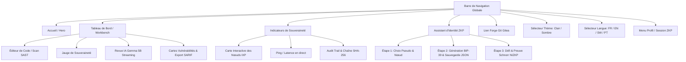

# ANALYSE CRITIQUE DU DESIGN, DE L'UX ET DE LA NAVIGATION — BANTUDEVLAB
## Document d'Ingénierie & Plan d'Amélioration Web : `develop-design.md`

> **Projet :** BANTUDEVLAB — Forge Logicielle Souveraine Panafricaine  
> **Cible :** Industrialisation UI/UX, Design System, Ergonomie Web et Accessibilité CADEV 2026  
> **Auteur :** Antigravity UX & Web Architecture  

---

## 1. ANALYSE CRITIQUE GLOBALE

### 1.1. État des lieux de l'expérience utilisateur (UX) & du Design
L'application BANTUDEVLAB dispose d'une identité de base forte (palette or/émeraude/terracotta reflétant les couleurs panafricaines, mode sombre par défaut, visualisations interactives comme la jauge SVG et la carte d'Afrique). Cependant, l'expérience souffre de plusieurs lacunes ergonomiques majeures :

1. **Absence de barre d'état utilisateur / Session persistante visible :**
   - L'utilisateur connecté ne voit pas son avatar, son nom, son statut de vérification ZKP ni son organisation dans la navbar.
   - Le bouton "Connexion Zero-Trust" reste affiché même quand la session est active.
2. **Navigation rigide et fragmentée :**
   - Pas de menu déroulant, pas de navigation contextuelle (breadcrumbs / fil d'Ariane).
   - Pas de drawer/menu hamburger mobile : la barre d'onglets déborde sur les écrans < 768px.
   - Lien sortant externe vers `http://localhost:3000` hardcodé et ouvrant un nouvel onglet sans indicateur visuel de sortie de plateforme.
3. **Thème unique sombre imposé (Dark Mode exclusif) :**
   - Variables CSS codées en dur pour un fond sombre (`--dark-bg: #0b0f19`). Aucun support de bascule Clair / Sombre (`light`/`dark`), ce qui pénalise les environnements à forte luminosité et ne respecte pas `prefers-color-scheme`.
4. **Absence totale de sélecteur et de système de langues (i18n) :**
   - Le texte est exclusivement en français, avec des chaînes codées en dur dans les templates.
   - Pour une plateforme panafricaine (CEDEAO, SADC, EAC), le support multilingue (**Français, Anglais, Portugais, Swahili, Arabe**) est indispensable.
5. **Incohérence des styles et styles inline massifs :**
   - Les gabarits contiennent des centaines d'attributs `style="..."` (ex: `style="display: flex; gap: 1rem; ..."`). Cela empêche l'optimisation CSS, alourdit le DOM et enfreint les bonnes pratiques de séparation des couches.
6. **Accessibilité & Contraste (WCAG 2.2) :**
   - Certains textes d'aide (`var(--text-muted): #9ca3af`) sur fond sombre `#111827` ont un ratio de contraste insuffisant (3.8:1 au lieu des 4.5:1 exigés par le niveau AA).
   - Manque d'attributs `aria-current="page"`, `aria-expanded`, et de navigation clavier au tabulateur.

---

## 2. SOLUTIONS TECHNIQUES & ARCHITECTURALES

### 2.1. Système de Design Tokens & Thème Clair / Sombre (Theme Switcher)
- Utilisation de CSS Custom Properties basées sur l'attribut `data-theme="dark|light"` sur la balise `<html>`.
- Synchronisation avec `localStorage` et écoute de l'événement système `window.matchMedia('(prefers-color-scheme: dark)')`.
- Composant commutateur élégant avec icône Soleil / Lune SVG.

### 2.2. Sélecteur de Langue & Internationalisation (i18n / l10n)
- Intégration du middleware Django `django.middleware.locale.LocaleMiddleware`.
- Sélecteur de langue dans la navbar (Drapeau/Code langue : FR, EN, SW, PT).
- Formulaire natif Django de sélection `set_language` sans rechargement lourd ou via cookie `django_language`.

### 2.3. Architecture de Navigation Globale & Contextuelle
- **Barre supérieure (Top Navigation) :**
  - Brand & Badge d'état réseau.
  - Liens principaux avec état actif dynamique (`aria-current="page"`).
  - Contrôles d'accessibilité : Thème (Soleil/Lune) + Langue (Sélecteur).
  - Profil utilisateur : badge de session ZKP, pays/nœud, bouton déconnexion.
  - Menu burger responsive pour tablettes et smartphones.
- **Barre contextuelle (Sub-nav / Breadcrumbs) :**
  - Fil d'Ariane sur les sous-pages (ex : `Accueil > Dépôts > afri-fintech > Scanner`).

### 2.4. Bibliothèque d'Icônes SVG & Accessibilité
- Abandon définitif de tout caractère Unicode/emoji.
- Utilisation intégrale du système de template tags Django `` et `` déjà configuré.
- Ajout de micro-interactions (hover effect, transitions fluides).

---

## 3. FEUILLE DE ROUTE DÉTAILLÉE DES TÂCHES (BACKLOG DESIGN & UX)

Les tâches ci-dessous sont ordonnées par phase de déploiement pour transformer l'application en interface web de grade institutionnel.

### PHASE 1 : Architecture Design System & Thème Clair/Sombre (Priorité Haute)
- [x] **DES-01 : Mise en place des Design Tokens Thématiques (CSS Variables)**
  - Définir les variables pour le thème Clair (`[data-theme="light"]`) : surfaces claires `#f8fafc`, bordures `#e2e8f0`, texte `#0f172a`, cartes `#ffffff`.
  - Maintenir les couleurs d'accentuation panafricaines (Or souverain `#d97706`/`#f59e0b`, Émeraude `#059669`/`#10b981`, Terracotta `#dc2626`).
  - Gérer les états d'ombre (`box-shadow`), les contrastes de focus (`:focus-visible`) et les états de survol.
- [x] **DES-02 : Composant Theme Toggle (Soleil / Lune) dans `base.html`**
  - Insérer un bouton bascule avec icônes SVG `sun` et `moon`.
  - Script JavaScript léger (<1 Ko) non bloquant dans le `<head>` pour éviter le flash blanc (FOUC).
  - Persistance dans `localStorage.getItem('bantu_theme')`.
- [x] **DES-03 : Élimination des styles inline et factorisation CSS**
  - Remplacer les styles inline des cartes, boutons et conteneurs par des classes utilitaires et composants BEM (`.bantu-card`, `.bantu-btn`, `.bantu-grid-4`, `.bantu-badge`).

### PHASE 2 : Navigation Responsive & Expérience Utilisateur (UX)
- [x] **NAV-01 : Navigation Responsive avec Menu Mobile (Drawer / Hamburger)**
  - Concevoir un bouton hamburger accessible (`aria-label="Menu principal"`, `aria-expanded="false"`).
  - Menu coulissant latéral animé sur mobile avec reprise de tous les liens et paramètres.
- [x] **NAV-02 : Détection de la page active et états de focus**
  - Créer un template filter Django ou fonction JS pour appliquer la classe `.active` et l'attribut `aria-current="page"` sur l'onglet correspondant à `request.path`.
- [x] **NAV-03 : Composant d'État Utilisateur (User Profile Dropdown)**
  - Si l'utilisateur est authentifié : afficher un avatar généré par identité ZKP (identicon SVG), son nom d'utilisateur, son pays avec ``, et un menu déroulant (Gérer mes tokens Git, Audit de ma clé, Déconnexion).
  - Si anonyme : bouton d'appel à l'action bien visible "Connexion Zero-Trust".
- [x] **NAV-04 : Fil d'Ariane & Retours contextuels (Breadcrumbs)**
  - Ajouter un composant de navigation secondaire sous la navbar permettant de revenir facilement au niveau parent.
- [x] **NAV-05 : Indicateur de lien externe pour la Forge Git**
  - Ajouter l'icône `external-link` à côté de "Accès Forge Git" et mention `aria-label="Ouvre la forge dans un nouvel onglet"`.

### PHASE 3 : Internationalisation (i18n) & Sélecteur de Langue
- [x] **I18N-01 : Configuration Django Locale & Rosetta / Po files**
  - Activer `django.middleware.locale.LocaleMiddleware` dans `settings.MIDDLEWARE`.
  - Définir `LANGUAGES = [('fr', 'Français'), ('en', 'English'), ('sw', 'Kiswahili'), ('pt', 'Português')]`.
  - Configurer `LOCALE_PATHS = [BASE_DIR / 'locale']`.
- [x] **I18N-02 : Sélecteur de Langue Accessible dans la barre d'outils**
  - Menu déroulant élégant avec code de langue et drapeau ou icône globe.
  - Endpoint de changement de langue vers `/i18n/setlang/`.
- [x] **I18N-03 : Traduction des gabarits principaux**
  - Remplacer les textes statiques par les balises `` et `` sur :
    - `templates/base.html` (navbar, footer, notifications).
    - `templates/core/home.html` (hero header, arguments souverains, cartes dépôts).
    - `templates/core/dashboard.html` (labels métriques, éditeur, onglets).
    - `templates/zkp_auth/login.html` (étapes du wizard, labels mnémotechniques, boutons d'action).
    - `templates/core/metrics.html` (indicateurs de latence, nœuds, datacenters).

### PHASE 4 : Composants d'Interface et Micro-Interactions
- [x] **UI-01 : Refonte du Wizard ZKP en étapes guidées (Stepper)**
  - Remplacer la navigation d'étapes actuelle par un stepper interactif fluide avec animations de transition gauche-droite.
  - Validation interactive des champs (nom d'utilisateur, clé hex) avec messages d'aide en temps réel.
  - Bouton de copie en un clic pour la clé publique et le mnémotechnique avec feedback visuel ("Copié !").
- [x] **UI-02 : Amélioration du Workbench de Sécurité & Éditeur**
  - Intégrer un sélecteur de langage de code (Python, Go, JavaScript, YAML, Dockerfile) dans la barre de titre de l'éditeur.
  - Afficher les numéros de ligne et surligner visuellement la ligne de code vulnérable détectée par le scanner.
  - Rendu Markdown fluide avec colorisation syntaxique pour les réponses de l'IA Gemma 5B.
- [x] **UI-03 : Carte Interactive Panafricaine Vectorielle (SVG amélioré)**
  - Rendre les points des nœuds (Abidjan, Dakar, Lagos, Kigali, Nairobi) entièrement accessibles au clavier (`tabindex="0"`, `role="button"`).
  - Infobulle (tooltip) flottante élégante au survol affichant la latence, la bande passante et l'autorité souveraine locale.
  - Affichage d'un badge de santé vert/orange/rouge dynamique basé sur l'API `/readyz`.

---

## 4. SCHÉMA DE NAVIGATION RECOMMANDÉ



---

## 5. PROPOSITION DE DESIGN TOKENS (CSS VARIABLES COMPLÈTES)

Voici la spécification CSS à intégrer dans `static/css/style.css` pour supporter immédiatement les thèmes Clair et Sombre :

```css
/* ==========================================================================
   BANTUDEVLAB DESIGN TOKENS — PALETTE CLAIR / SOMBRE SOUVERAINE
   ========================================================================== */

:root {
  /* Couleurs immuables panafricaines */
  --color-gold-500: #f59e0b;
  --color-gold-600: #d97706;
  --color-emerald-500: #10b981;
  --color-emerald-600: #059669;
  --color-terracotta-500: #dc2626;
  --color-terracotta-600: #b91c1c;

  /* Typographie & Rythme */
  --font-sans: 'Inter', system-ui, -apple-system, BlinkMacSystemFont, "Segoe UI", Roboto, sans-serif;
  --font-mono: 'JetBrains Mono', 'Fira Code', Menlo, Monaco, Consolas, monospace;
  --radius-sm: 6px;
  --radius-md: 10px;
  --radius-lg: 16px;
  --transition-speed: 0.25s;
}

/* Thème Sombre (Défaut) */
:root, [data-theme="dark"] {
  --bg-app: #080c14;
  --bg-surface: #0f172a;
  --bg-surface-elevated: #1e293b;
  --border-subtle: #1e293b;
  --border-strong: #334155;
  --text-primary: #f8fafc;
  --text-secondary: #94a3b8;
  --text-muted: #64748b;
  --accent-gold: var(--color-gold-500);
  --accent-emerald: var(--color-emerald-500);
  --accent-terracotta: var(--color-terracotta-500);
  --shadow-card: 0 10px 25px -5px rgba(0, 0, 0, 0.5), 0 8px 10px -6px rgba(0, 0, 0, 0.4);
  --navbar-bg: rgba(15, 23, 42, 0.92);
}

/* Thème Clair (High Visibility & Institutional) */
[data-theme="light"] {
  --bg-app: #f8fafc;
  --bg-surface: #ffffff;
  --bg-surface-elevated: #f1f5f9;
  --border-subtle: #e2e8f0;
  --border-strong: #cbd5e1;
  --text-primary: #0f172a;
  --text-secondary: #475569;
  --text-muted: #64748b;
  --accent-gold: var(--color-gold-600);
  --accent-emerald: var(--color-emerald-600);
  --accent-terracotta: var(--color-terracotta-600);
  --shadow-card: 0 4px 6px -1px rgba(0, 0, 0, 0.08), 0 2px 4px -2px rgba(0, 0, 0, 0.05);
  --navbar-bg: rgba(255, 255, 255, 0.95);
}
```

---

## 6. CRITÈRES DE SUCCÈS & ACCEPTATION (DEFINITION OF DONE UX/UI)

1. **Test d'Accessibilité :** Score Lighthouse Accessibilité **≥ 98/100** sur Desktop et Mobile.
2. **Support Thème :** Bascule instantanée Clair/Sombre sans rechargement de page et persistance après rafraîchissement.
3. **Responsive Design :** Navigation fluide et lisible sans débordement horizontal de 320px à 2560px de largeur d'écran.
4. **Zéro Emoji :** Conformité 100% au script `python scripts/check_no_emoji.py` avec icônes et drapeaux vectoriels SVG.
5. **Préparation Multilingue :** Sélecteur de langue présent et prêt pour l'intégration des fichiers `.po` de traduction.
