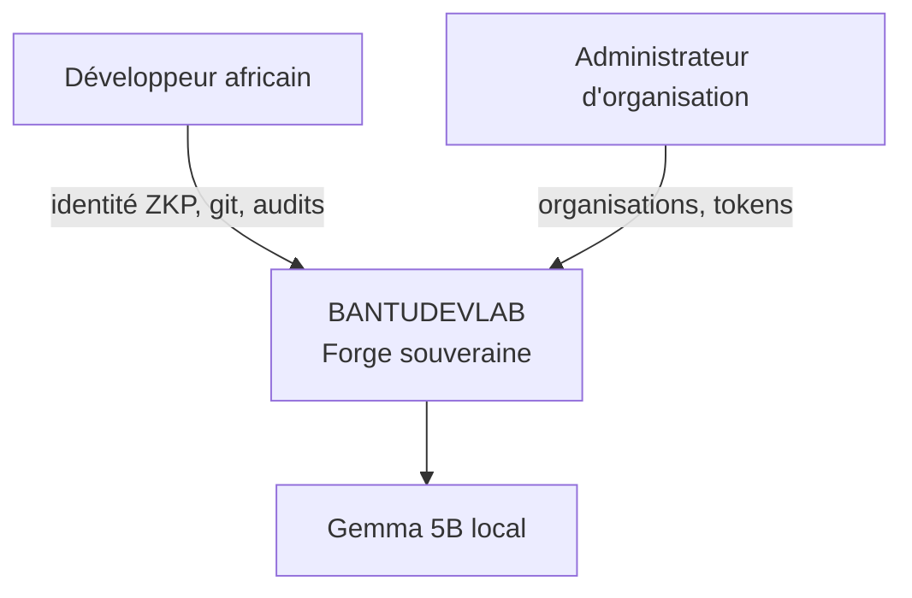
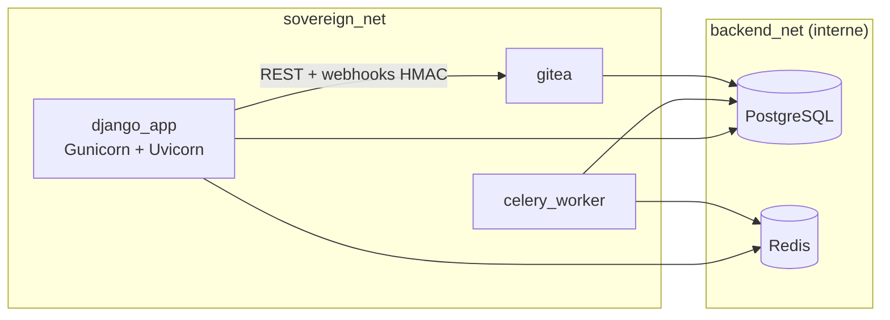
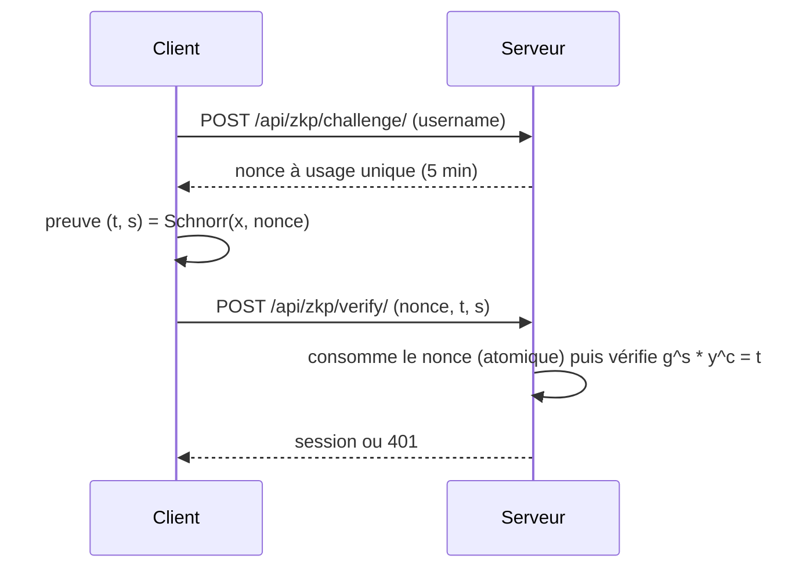

# Architecture

## Contexte (C4 niveau 1)

## Conteneurs (C4 niveau 2)

## Composants Django

| Application | Responsabilité |
|---|---|
| `apps.core` | Pages, organisations multi-tenant, journal d'audit chaîné, santé, icônes |
| `apps.zkp_auth` | Identités souveraines, défis, preuves de Schnorr, tokens Git |
| `apps.gitea_client` | Client Gitea (circuit breaker, cache), webhook, synchronisation |
| `apps.security_scanner` | Analyse statique, score de souveraineté, export SARIF |
| `apps.ai_assistant` | Revue de code Gemma (JSON ou SSE), journalisation sans secrets |

## Flux d'authentification

## Décisions d'architecture (ADR)

### ADR-001 - Gitea comme moteur Git, surcouche Django
- **Contexte** : écrire un moteur Git est hors de portée ; Gitea est open source, léger et auto-hébergeable.
- **Décision** : Gitea gère les dépôts ; Django ajoute identité ZKP, audit, scanner et IA.
- **Conséquences** : couplage par API REST et webhooks (signés) ; circuit breaker pour la résilience.

### ADR-002 - ZKP de Schnorr (Fiat-Shamir) pour l'identité
- **Décision** : aucune donnée secrète ne transite ; le serveur stocke uniquement `y = g^x mod p`.
- **Conséquences** : pas de mot de passe à voler ; perte de la clé = perte du compte (récupération à concevoir, voir backlog T-055). Voir [crypto-spec](security/crypto-spec.md).

### ADR-003 - IA locale (Gemma 5B)
- **Décision** : inférence sur l'infrastructure souveraine (Ollama/vLLM) ; repli par règles hors ligne.
- **Conséquences** : le code ne quitte pas la juridiction ; secrets masqués avant journalisation.

### ADR-004 - Sécurité par défaut
- **Décision** : `IsAuthenticated` par défaut, aucun secret par défaut, `DEBUG=False`, réseau Docker interne pour les données.
- **Conséquences** : toute nouvelle route publique doit être déclarée et justifiée en revue.

### ADR-005 - Icônes SVG auto-hébergées
- **Décision** : balises ``/`` rendant du SVG en ligne ; aucun emoji ni CDN.
- **Conséquences** : rendu identique sur tous les systèmes (les drapeaux emoji ne s'affichent pas sous Windows), compatible CSP stricte.
